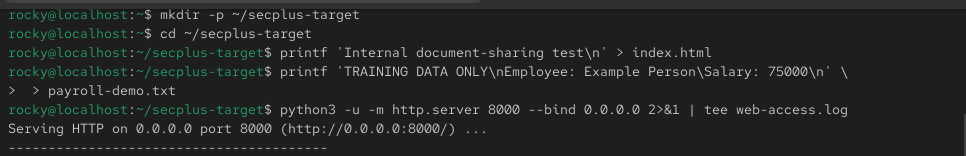
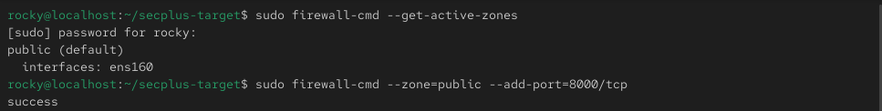
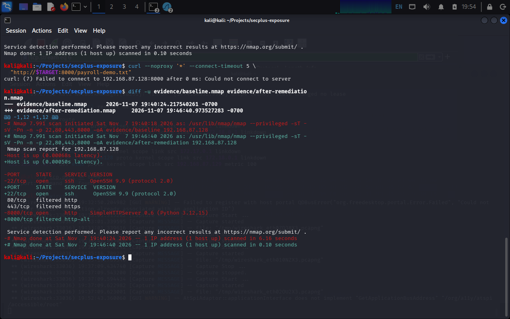
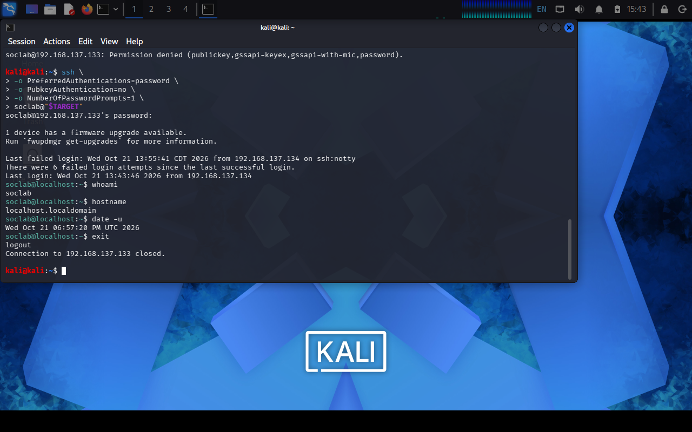
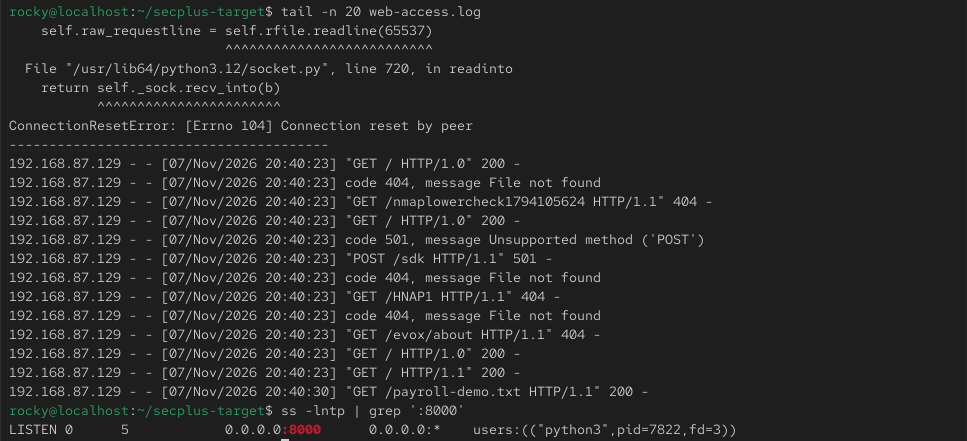
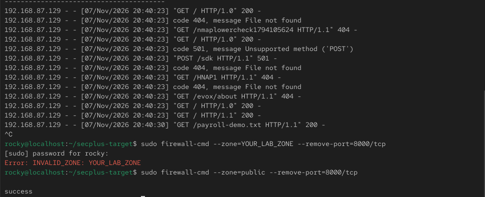

# LAB-002: HTTP Exposure Assessment and Remediation

## Activity status

Pending execution evidence. This document records the planned procedure; no execution outputs or screenshots have been supplied or verified. Expected results below are not claims of completed work.

## Purpose and scope

Assess a temporary web service exposing a fake payroll document, collect network and server-side evidence, remove the unnecessary service, and validate the change. Use only owned or explicitly authorized VMs on an isolated internal/private network. Disconnect bridged and NAT adapters during testing, take snapshots, and use fake data only. Install tools before isolation.

## Environment

- Analyst: Kali Linux with Nmap, curl, and Wireshark.
- Target: Rocky Linux, Ubuntu, or Debian with Python 3.
- Example addresses: Kali 192.168.77.10/24; target 192.168.77.20/24. Replace with actual lab addresses and avoid overlapping subnets.
- Date/time and timezone: [record].
- Actual addresses and VM versions: [record].

## 1. Prepare the analyst workstation

Check addresses on both VMs using `ip -br addr`. On Kali:

```bash
export TARGET=192.168.77.20
mkdir -p ~/secplus-exposure/evidence
cd ~/secplus-exposure
```

## 2. Create the intentional exposure

On the target:

```bash
mkdir -p ~/secplus-target ~/secplus-logs
cd ~/secplus-target
printf 'Internal document-sharing test\n' > index.html
printf 'TRAINING DATA ONLY\nEmployee: Example Person\nSalary: 75000\n' > payroll-demo.txt
python3 -u -m http.server 8000 --bind 0.0.0.0 2>&1 | tee ~/secplus-logs/web-access.log
```

Leave the server terminal running. Logs remain outside the served directory. If Rocky's firewall blocks access, inspect active zones and temporarily allow TCP 8000 only in the lab interface's zone:

```bash
sudo firewall-cmd --get-active-zones
sudo firewall-cmd --zone=YOUR_LAB_ZONE --add-port=8000/tcp
```

Replace YOUR_LAB_ZONE with the actual zone. Do not disable the firewall. Record any exception for cleanup.

## 3. Assess the exposure

On Kali:

```bash
nmap -sT -sV -Pn -n -p 22,80,443,8000 -oA evidence/baseline "$TARGET"
curl --noproxy '*' -v "http://$TARGET:8000/payroll-demo.txt" -o evidence/retrieved-payroll.txt 2> evidence/http-details.txt
cat evidence/retrieved-payroll.txt
```

Expected: port 8000 is open and the fake document is accessible without authentication. The finding is inappropriate document access, not merely an open port.

Actual port state, service, HTTP status, and access observations: [record].

## 4. Capture and correlate evidence

Capture on Kali's isolated interface in Wireshark, repeat the request, and filter with `tcp.port == 8000`. Use Follow > TCP Stream to inspect the request and response. Save the capture locally as `evidence/http-exposure.pcapng`.

In a second target terminal:

```bash
tail -n 20 ~/secplus-logs/web-access.log
ss -lntp | grep ':8000'
```

Correlate the client IP, request time, path, and status with the capture, accounting for timezone differences.

Actual packet, log, and listener observations: [record].

## 5. Remediate

Assume the temporary service is no longer required. Press Ctrl+C in its terminal. Remove any temporary firewall exception using the same zone:

```bash
sudo firewall-cmd --zone=YOUR_LAB_ZONE --remove-port=8000/tcp
ss -lntp | grep ':8000'
```

Run the firewall command only if the exception was added. Expected listener-check result: no match.

Actual changes and local verification: [record].

## 6. Validate from Kali

```bash
nmap -sT -sV -Pn -n -p 22,80,443,8000 -oA evidence/after-remediation "$TARGET"
curl --noproxy '*' --connect-timeout 5 "http://$TARGET:8000/payroll-demo.txt"
diff -u evidence/baseline.nmap evidence/after-remediation.nmap
```

Expected: port 8000 is no longer open and retrieval fails. Closed versus filtered depends on firewall behavior. Corroborate the result with the local listener check and recorded firewall changes.

Actual follow-up scan, request result, and remediation status: [record].

## Evidence and screenshots

No screenshots have been attached yet. Add only genuine, reviewed captures from this activity; do not fabricate outputs or substitute example images.

| Suggested filename | What it should demonstrate | Status |
| --- | --- | --- |
| 01-baseline-scan.png | Actual target and initial service exposure | Pending |
| 02-document-access.png | Retrieval of the fake document | Pending |
| 03-http-stream.png | Request and response in the captured TCP stream | Pending |
| 04-server-log.png | Corresponding request and client address | Pending |
| 05-remediation-validation.png | Follow-up scan and failed retrieval | Pending |

Store screenshots in this lab's screenshots directory when available and embed them here with captions. Retain sanitized scan and log excerpts as supporting evidence. Keep raw captures private unless inspected and sanitized. Remove credentials, real personal information, and unrelated traffic before publishing.

## Finding and limitations

- Finding: [record demonstrated unauthenticated document access].
- Potential impact: disclosure if real sensitive documents were hosted.
- Remediation performed: [record].
- Validation evidence: [reference actual artifacts].
- Limitations: only four specified TCP ports and this document exposure are in scope; this is not a comprehensive vulnerability assessment.

## Lessons learned

[Complete after execution. Explain what the evidence established, what changed, and what remains untested.]

[Lab index and naming guide](../README.md)

## Uploaded terminal screenshots

The following terminal captures document the activity. Interpret results using the commands and output visible in each image.

### Victim: web-server misconfiguration



### Victim: temporary firewall exception



### Attack: reconnaissance scan



### Attack: document access



### Victim: access log



### Victim: firewall exception removal



